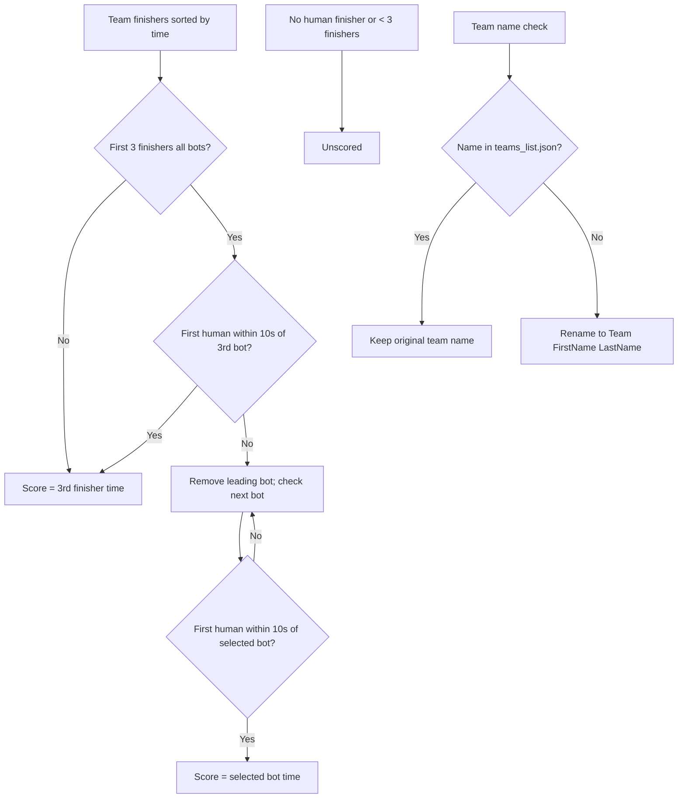

# TPV Result Parser

TPV Result Parser is a static Progressive Web App for preparing TrainingPeaks Virtual race results. The PWA reads selected files in the browser; race files are not uploaded to a server and the Process button does not start a GitHub Action.

## Browser features

- Process one or more CSV files, or CSV files inside a ZIP archive.
- Read the `OVERALL INDIVIDUAL RESULTS` section and ignore team-only and intermediate-result sections.
- Keep every rider (including bots) from teams that have at least one non-bot UID; omit teams with only bots.
- Apply an optional team rename. If the official team list is available, unlisted teams are labeled `Team FirstName LastName` using the fastest human rider; listed team names stay unchanged.
- Show team time-trial standings separately from the upload-ready individual rider CSV.
- Download one race as a CSV, or multiple races as a ZIP of processed CSV files.
- Keep processed race tabs in the open browser session. Reprocessing the same race name appends and sorts the rider rows.
- Use the TPV team list refreshed by the scheduled GitHub Action.

## Team standings scoring rules

- Default score: the third finisher's time.
- If the first three finishers are all bots:
  - Check whether the first human is within 10 seconds of the third bot.
  - If yes: use the third finisher's time.
  - If no: remove the leading bot(s) one by one until the first human is within 10 seconds of the selected bot; use that bot's time.
- Unscored cases:
  - No human finisher.
  - Fewer than three finishers.
- Team names: names found in the TPV team list (`teams_list.json`) stay unchanged; names not in that list become `Team FirstName LastName`.
- The downloadable CSV preserves the original individual-results columns and all qualifying riders; standings are shown in the PWA.

## Use the hosted PWA

Open https://jc-concepts.github.io/TPV-ResultParser/, select CSV and/or ZIP files, optionally enter a race name or team rename, then choose **Process**. Use **Download** after processing. Multiple CSVs in one batch are kept as separate race results; the download is a ZIP when the batch produces multiple races.

Files are read and processed in browser memory. The app uses no GitHub token and sends no race-file contents to GitHub Actions.

## Team list refresh

A scheduled job updates the team list once a day from the TPV Hub site. The updated list is saved as `teams_list.json` and published with the site so the PWA can recognize official team names.

The manually dispatched `process.yml` workflow is separate from the PWA and cannot receive a file selected in the browser.
